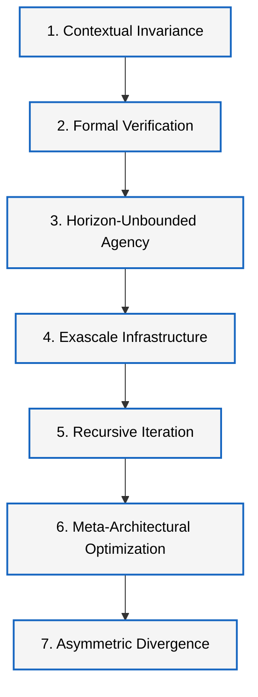

# ASI Arrival Forecast

> **Current release: v0.6.0 — recalibrated on evidence to 2026-10-06.**
> Experimental, auditable research model; not a consensus forecast and not advice.
> The historical v0.5.1 calibration is preserved unchanged and still reproducible
> (`--config forecast_inputs/base_forecast_inputs.yaml`).

## Headline (v0.6.0, scenario A — evidence-weighted posterior mixture, 100,000 sims)

| Target | 10% | 50% (median) | 90% |
|---|---|---|---|
| AGI | 2026-10 (10% "already AGI" judgement) | **2029-01** | 2033-10 |
| Internal ASI | 2029-05 | **2032-04** | 2038-10 |
| Public ASI | 2029-12 | **2033-02** | 2039-11 |

AGI → internal-ASI lag: median **2.9 years**; P(< 1 year) = 5%; P(< 2 years) = 27%.
P(internal ASI by 2030) = 32%, by 2035 = 81%.
Conditional scenarios: **B** AGI-era/fast takeoff → internal ASI median 2029-07;
**C** bottlenecked → 2038-09.

The two dominant inputs cannot be measured directly: whether METR-style task
horizons keep doubling every ~3-5 months past the point where they can be measured,
and the effective-compute gap (OOM) between AGI and ASI. Both are flagged and stress-tested.

* Full analysis: [research_note/2026_10_recalibration.md](research_note/2026_10_recalibration.md)
* Pre-change audit: [research_note/2026_10_model_audit.md](research_note/2026_10_model_audit.md)
* Archived outputs: `historical_runs/v0_6_0/` (v0.6.0) and `historical_runs/v0_5_1_unchanged/`
* Every live parameter: [evidence_tables/v0_6_parameter_sources.csv](evidence_tables/v0_6_parameter_sources.csv);
  every source: [evidence_tables/v0_6_evidence_2026.csv](evidence_tables/v0_6_evidence_2026.csv)

### What v0.6 changed structurally

* **AGI stage:** horizon-trend gate re-anchored at 2026-10. It adds pre-AGI
  acceleration, a compute-linked slowdown, an explicit paradigm-wall branch (replacing
  the 15% teleport to 2040), and an explicit "already AGI" (H2) probability.
* **AGI → ASI:** the fixed sum of lags (including a hard 12-month infrastructure floor)
  is replaced by a capability-dependent AI-R&D feedback model. It uses an Amdahl
  automation fraction, returns to software R&D r, parallel-labour returns p, and a
  compute-bottleneck cap, all run under a Bayesian mixture of four takeoff regimes
  (bottlenecked 36%, moderate 38%, fast 20%, recursive 6%).
* **Correlated evidence:** a shared latent progress factor, plus within-group averaging
  in the regime update, so the same trend is not counted twice.

### v0.5.1 (historical) comparison

| Model / survey | 10% | 50% | 90% |
|---|---|---|---|
| v0.5.1 AGI | 2029-12 | 2031-07 | 2048-10 |
| v0.5.1 internal ASI | 2032-05 | 2034-05 | 2051-07 |
| v0.6.0 AGI | 2026-10 | 2029-01 | 2033-10 |
| v0.6.0 internal ASI | 2029-05 | 2032-04 | 2038-10 |
| Metaculus "general AI" (incl. robotics), ~Oct 2026 | – | ~2031-04 | – (displayed range May 2028–Nov 2037; interval type unverified) |
| ESPAI 2023 (HLMI) | – | 2047 | – |
| Cotra Bio Anchors (TAI) | 2031 | 2052 | >2100 |

## Forecasting AGI and ASI separately

This repository runs a public, auditable Monte Carlo forecast for two related but distinct targets:

1. **AGI / transformative general AI**
2. **Capability-and-agency ASI**

Most public evidence is about AGI, coding agents, compute, benchmarks, and AI R&D automation. ASI is further downstream. This repo therefore forecasts AGI first, then models the uncertain transition from AGI to ASI.

```text
AGI capability threshold
        |
        v
AI R&D automation
        |
        v
superhuman AI researcher
        |
        v
accelerated / recursive AI progress
        |
        v
internal ASI
        |
        v
public ASI
```

## Definitions

**AGI** means an AI system that can perform or automate a very wide range of economically valuable cognitive tasks at approximately top-human or expert-human level, including software engineering, analysis, research assistance, planning, computer use, and general problem-solving across novel domains.

**Capability-and-agency ASI** means an AI system or AI-agent system that can outperform top human teams across most important cognitive work, including AI research, software engineering, scientific discovery, mathematics, cybersecurity, strategy, and long-horizon autonomous tasks; can generalise to novel tasks; and can pursue objectives using planning, memory, tool use, self-correction, and coordination.

## Why Split AGI And ASI?

- AGI and ASI are not the same.
- AGI means broadly human/expert-level general capability.
- ASI means beyond top human teams.
- Most evidence directly informs AGI or intermediate milestones.
- ASI is modelled as a later stage conditional on AGI plus AI R&D automation and takeoff dynamics.

The model does **not** treat AGI evidence as direct ASI evidence.

## Refined 7-Checkpoint Capability Ladder

The project also uses a refined 7-checkpoint capability ladder as a qualitative
screen for interpreting new evidence. The ladder is not a separate forecast
target. It helps decide whether an observation should update AGI timing,
AGI-to-ASI transition lags, infrastructure friction, AI R&D automation, or the
internal ASI threshold.



1. **Contextual Invariance (memory)**  
   Metric: lossless, deterministic semantic retrieval across a continuous
   10^8-token context window, with less than 0.01% performance decay in
   needle-in-a-haystack tracking.  
   Why it matters: eliminates state drift across full codebases, scientific
   literatures, enterprise logs, and long execution loops.

2. **Autonomous Formal Verification (math)**  
   Metric: independent, closed-loop formalization and proof generation for an
   unverified mathematical conjecture or non-trivial software kernel using a
   verified proof assistant such as Lean 4, with zero human prompting.  
   Why it matters: creates a hard gate for verified reasoning and reduces human
   review as a bottleneck for trustworthy code and logic changes.

3. **Horizon-Unbounded Agency (agency)**  
   Metric: sustained, continuous execution of multi-turn, cross-domain
   engineering objectives across a 336-hour (14-day) production run, with
   dynamic self-correction, tool use, and a 0% fatal exception rate.  
   Why it matters: moves the system from assistant behavior toward autonomous
   employee behavior on large research and engineering projects.

4. **Exascale Infrastructure Hardening (compute)**  
   Metric: sustained orchestration of a single distributed optical cluster
   drawing >=1.2 GW of power, maintaining >99.99% hardware utilization and
   fault-tolerant state checkpointing over a 30-day training window.  
   Why it matters: shows that scaling is no longer just model-side capability;
   it is industrial-scale compute, power, and reliability control.

5. **Recursive Synthetic Iteration (data)**  
   Metric: monotonic, measurable capability gains across five consecutive
   generations of fully synthetic, model-generated data loops, without model
   collapse.  
   Why it matters: breaks the bottleneck imposed by finite human-generated
   training data.

6. **Meta-Architectural Optimization (R&D)**  
   Metric: automated design, compilation, and algorithmic validation of a novel
   neural architecture or training paradigm that delivers a >=10% compute
   efficiency gain, measured as FLOP reduction against state-of-the-art
   baselines.  
   Why it matters: turns AI into a direct AI R&D accelerator by finding
   structural efficiencies humans missed.

7. **Asymmetric Takeoff Divergence (takeoff)**  
   Metric: cross-domain capability accumulation velocity exceeding 100x the
   cumulative human engineering baseline per hour, driven by autonomous,
   multi-tiered recursive self-improvement loops.  
   Why it matters: identifies the regime where calendar time stops being a good
   proxy for capability change.

## What Monte Carlo Means

Monte Carlo means running thousands or millions of possible futures by sampling uncertain inputs.

The median is the 50/50 month: half the simulated futures arrive before it, half after it.

More simulations reduce numerical noise. They do not make bad assumptions true.

## Architecture

```text
evidence_notes + evidence_tables
        |
        v
forecast_inputs
        |
        v
stage-gated AGI -> ASI simulation
        |
        v
arrival month distributions
        |
        v
forecast drivers
        |
        v
latest report
```

Important files:

- [forecast_inputs/v0_6/inputs.yaml](forecast_inputs/v0_6/inputs.yaml): v0.6 inputs (default), with scenarios.
- [forecast_inputs/base_forecast_inputs.yaml](forecast_inputs/base_forecast_inputs.yaml): historical v0.5.1 inputs (unchanged).
- [forecast_inputs/author_prior_scenario.yaml](forecast_inputs/author_prior_scenario.yaml): separate July 2029 author-prior scenario.
- [forecast_inputs/agi_definition.yaml](forecast_inputs/agi_definition.yaml): AGI definition.
- [forecast_inputs/asi_definition.yaml](forecast_inputs/asi_definition.yaml): ASI definition.
- [forecast_inputs/milestone_definitions.yaml](forecast_inputs/milestone_definitions.yaml): stage-gate definitions.
- [forecast_inputs/capability_ladder.yaml](forecast_inputs/capability_ladder.yaml): qualitative 7-checkpoint capability ladder.
- [evidence_tables/agi_evidence.csv](evidence_tables/agi_evidence.csv): AGI/TAI evidence.
- [evidence_tables/asi_evidence.csv](evidence_tables/asi_evidence.csv): ASI/takeoff evidence.
- [evidence_tables/intermediate_milestones.csv](evidence_tables/intermediate_milestones.csv): compute, coding, agents, AI R&D automation, and governance inputs.
- [src/asi_forecast/v06/engine.py](src/asi_forecast/v06/engine.py): v0.6 engine (AGI gate + takeoff dynamics).
- [src/asi_forecast/monte_carlo.py](src/asi_forecast/monte_carlo.py): historical v0.5.1 simulation.
- [src/asi_forecast/model.py](src/asi_forecast/model.py): stage-gated equations.

## Quickstart

```bash
python3 -m venv .venv
source .venv/bin/activate
pip install -e '.[dev]'
pytest
asi-forecast run --target both --sims 100000                    # v0.6 scenario A
asi-forecast run --scenario agi_era_fast --sims 100000          # scenario B
asi-forecast run --scenario bottlenecked --sims 100000          # scenario C
asi-forecast drivers --sims 100000                              # Spearman + factor tornado
asi-forecast report --sims 100000 --sensitivity-sims 40000      # full study + dashboard
asi-forecast run --config forecast_inputs/base_forecast_inputs.yaml   # historical v0.5.1
```

For a faster local check:

```bash
asi-forecast run --target both --sims 10000
```

## CLI

```bash
asi-forecast run --target agi --sims 100000
asi-forecast run --target asi --sims 100000
asi-forecast run --target both --sims 100000
asi-forecast explain
asi-forecast explain-targets
asi-forecast inputs
asi-forecast evidence
asi-forecast drivers
asi-forecast report
asi-forecast clean-results
```

## Generated Results

Generated files go to `results/`:

- `forecast_summary.csv`
- `forecast_metrics.csv`
- `latest_forecast_report.md`
- `simulated_agi_arrival_months.csv`
- `simulated_internal_asi_arrival_months.csv`
- `simulated_public_asi_arrival_months.csv`
- `simulated_agi_to_asi_lags.csv`
- `arrival_probability_distribution.png`
- `agi_to_asi_lag_distribution.png`
- `forecast_drivers.csv`
- `what_drives_the_forecast.png`

Generated results are ignored by git by default.

## Status

Experimental research prototype. Not investment, legal, policy, or safety advice.

This repo is designed to be inspectable and editable. It should be judged by whether its assumptions are visible, its evidence is classified honestly, and its outputs do not overclaim.
